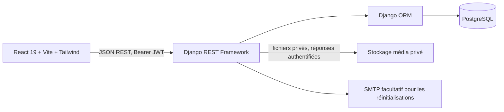
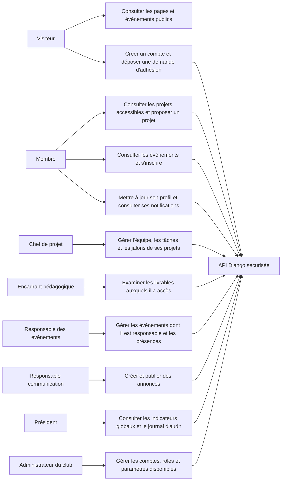
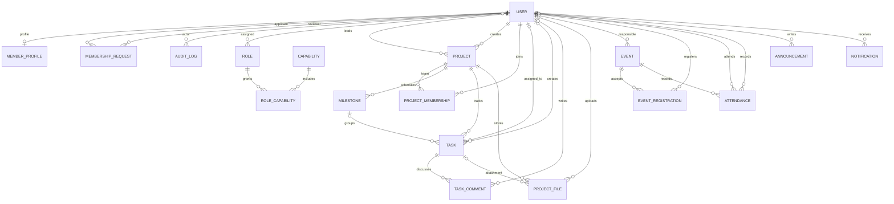
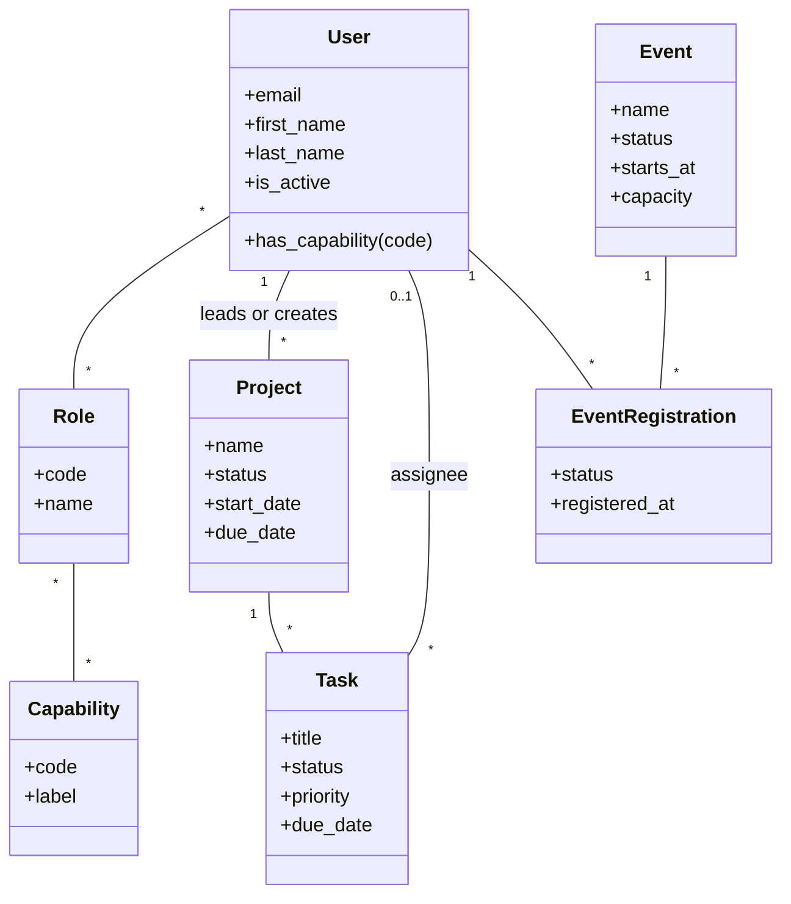

# Architecture MyClub

## Architecture d'exécution

Le frontend appelle `/api/v1/` via Axios. Les règles d'autorisation vivent dans Django; les contrôles du frontend servent à adapter la navigation, pas à protéger les données. PostgreSQL est la base normale de l'application. Le profil SQLite en mémoire sert uniquement aux tests rapides. Les snapshots MongoDB sont une source historique pour l'import contrôlé; MyClub ne s'y connecte pas à l'exécution.

## Applications et responsabilités

| Application | Responsabilités principales |
|---|---|
| `apps.members` | Utilisateurs Django, rôles, capacités, profils, demandes d'adhésion et journal d'audit. |
| `apps.projects` | Projets, équipes, tâches, commentaires, jalons et fichiers privés. |
| `apps.events` | Événements, inscriptions et présences. |
| `apps.announcements` | Annonces et notifications individuelles. |
| `clubsite` | Configuration, middleware et routes de l'API. |

## Rôles seedés et matrice de capacités

La migration actuelle sème les huit rôles ci-dessous. Cette matrice décrit le code du dépôt; elle reste **provisoire jusqu'à comparaison avec le cahier des charges initial du Club DIA**, absent des fichiers fournis. Aucun rôle n'est ajouté ou fusionné dans ce document.

| Code | Nom affiché | Capacités seedées |
|---|---|---|
| `visitor` | Visiteur | `events.view_events` |
| `member` | Membre | `projects.view_projects`, `projects.propose_project`, `events.view_events`, `announcements.view_member` |
| `club_admin` | Administrateur du club | Toutes les capacités ci-dessous |
| `project_lead` | Chef de projet | `projects.view_projects`, `projects.propose_project`, `projects.manage_team`, `projects.manage_tasks`, `projects.review_deliverables` |
| `president` | Président du club | `projects.view_projects`, `events.view_events`, `announcements.view_member`, `audit.view_audit`, `dashboard.view_all` |
| `event_manager` | Responsable des événements | `events.view_events`, `events.manage_events`, `events.manage_attendance`, `announcements.view_member` |
| `pedagogical_supervisor` | Encadrant pédagogique | `projects.view_projects`, `projects.review_deliverables` |
| `communications_manager` | Responsable de la communication | `announcements.view_member`, `announcements.manage_announcements` |

Capacités connues :

- Membres : `members.view_members`, `members.manage_members`, `members.review_membership`, `members.manage_roles`.
- Projets : `projects.view_projects`, `projects.propose_project`, `projects.manage_projects`, `projects.manage_team`, `projects.manage_tasks`, `projects.review_deliverables`.
- Événements : `events.view_events`, `events.manage_events`, `events.manage_attendance`.
- Communication : `announcements.view_member`, `announcements.manage_announcements`.
- Transversal : `audit.view_audit`, `dashboard.view_all`.

Un superutilisateur Django est un compte système et reçoit toutes les capacités côté serveur. L'interface reçoit maintenant son indicateur `is_superuser` depuis `/auth/me/` et la réponse de connexion.

## Diagramme des cas d'utilisation

Les opérations auxquelles un rôle n'a pas droit sont refusées côté API, indépendamment de l'affichage du frontend. Les affectations à un projet et la responsabilité d'un événement ajoutent des contrôles par ressource.

## Modèle relationnel (ERD)

Les contraintes importantes incluent l'unicité d'un rôle par capacité, d'un membre par projet, d'une inscription et d'une présence par personne/événement, ainsi qu'une demande d'adhésion en attente par compte. Le modèle d'événement contrôle l'ordre des dates et la capacité positive.

## Diagramme de classes simplifié

## API et documentation

La documentation interactive OpenAPI est servie par Swagger à `/api/v1/docs/`; le schéma JSON est à `/api/v1/openapi.json`.

| Domaine | Routes principales |
|---|---|
| Authentification | `/auth/signup/`, `/auth/login/`, `/auth/refresh/`, `/auth/logout/`, `/auth/me/`, `/auth/password/change/`, `/auth/password/reset/` |
| Membres/adhésions | `/members/`, `/members/{id}/roles/`, `/members/{id}/activate/`, `/members/{id}/deactivate/`, `/membership-requests/`, `/membership-requests/{id}/review/` |
| Projets/équipes | `/projects/`, `/projects/{id}/`, `/project-memberships/`, `/project-memberships/candidates/`, `/milestones/` |
| Tâches/livrables | `/tasks/`, `/tasks/{id}/comments/`, `/task-comments/`, `/milestones/{id}/complete/`, `/project-files/`, `/project-files/{id}/download/` |
| Événements | `/events/`, `/events/{id}/register/`, `/events/{id}/participants/`, `/events/{id}/attendance/`, `/events/{id}/export_participants/` |
| Communication | `/announcements/`, `/notifications/`, `/notifications/{id}/mark_read/` |
| Indicateurs/audit | `/dashboard/summary/`, `/audit-logs/` |

Les listes utilisent la pagination DRF par numéro de page et acceptent les filtres, la recherche ou le tri déclarés par chaque ViewSet. Les réponses privées demandent un jeton `Authorization: Bearer …`.

## Limites actuelles

- La disponibilité PostgreSQL, les migrations en base et la configuration réelle de production n'ont pas été validées le 19 novembre 2026.
- Le mapping des comptes MongoDB historiques `admin` vers `club_admin` exige une option d'approbation explicite pendant l'import.
- Les statuts d'adhésion suspendue/archivée et les règles de conservation doivent être définis avant d'étendre le modèle.
- Le dashboard partage actuellement certaines sections plutôt que de proposer huit écrans entièrement distincts.
